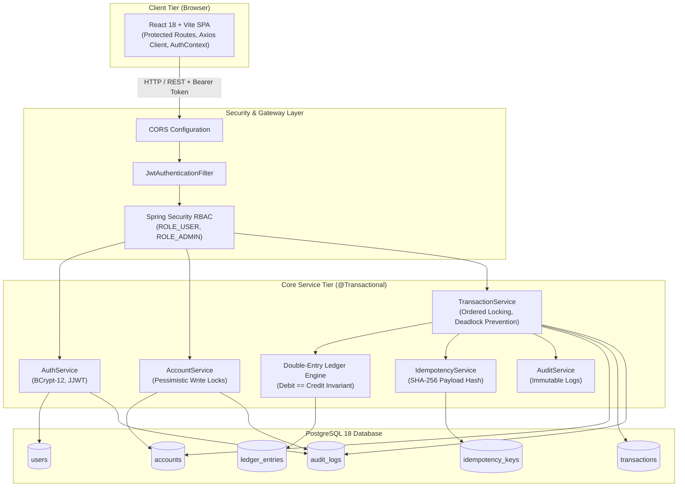

# MoneyMe — Smart Money Movement with a Ledger You Can Trust

**Snovasys Fresher Hiring Challenge 2026 Submission**

---

## 1. Project Title
**MoneyMe: Full-Stack Financial Management & Double-Entry Ledger System**

## 2. Project Overview
MoneyMe is an enterprise-grade financial management application engineered for bulletproof money movement, account handling, and accurate ledger balancing. Designed with strict compliance to banking integrity standards, every transaction is backed by an append-only double-entry ledger, deadlock-free concurrency locks, cryptographic idempotency safeguards, and server-side role-based access control.

## 3. Problem Statement
Many financial and transactional applications suffer from silent ledger drift, double spending under rapid double-clicks, race conditions during simultaneous transfers, and partial failure states where funds leave a sender's balance without arriving at the recipient. MoneyMe resolves these critical vulnerabilities by introducing transactional atomicity, ordered pessimistic database locking, and strict zero-sum double-entry accounting.

## 4. Objectives
- Ensure **$\sum \text{Debits} = \sum \text{Credits}$** across all completed financial operations.
- Prevent double spending, negative balances, and concurrency deadlocks.
- Enforce strict server-side authentication and authorization using JWT and BCrypt.
- Provide a clean, responsive, and intuitive React dashboard for users and administrators.
- Supply an append-only immutable audit trail and idempotency layer for payment retries.

---

## 5. Key Features

### User Features
- **Secure Authentication:** User registration, BCrypt password hashing, and JWT token issuance.
- **Financial Dashboard:** Real-time calculation of total available balances, verified deposit totals, withdrawal totals, and recent transaction feeds.
- **Multi-Account Management:** Create multiple checking/savings accounts in supported currencies (USD, INR, EUR, GBP) with automatic unique account number allocation.
- **Deposits:** Deposit funds directly into user-owned accounts with positive amount constraints.
- **Withdrawals:** Withdraw funds with real-time balance checks preventing negative balances.
- **Peer-to-Peer Transfers:** Transfer money between MoneyMe accounts with atomic execution and deadlock prevention.
- **Transaction History:** Filterable transaction logs by type (DEPOSIT, WITHDRAWAL, TRANSFER) and status.

### Admin Features
- **Admin Command Center:** System-wide telemetry displaying total registered users, active accounts, gross movement volume, and system-wide transaction counts.
- **User Oversight:** Inspect registered user identities, assigned roles, and timestamps.
- **Ledger Verification:** Audit all system transactions and underlying ledger records.

---

## 6. Technology Stack

### Backend
- **Java 17 / 21 LTS**
- **Spring Boot 3.3.5** (Spring Web, Spring Data JPA, Spring Security, Validation)
- **Database:** PostgreSQL 18 (with H2 in-memory profile for autonomous automated test suites)
- **Security:** JJWT (JSON Web Token 0.12.5), BCrypt Password Encoder
- **Testing:** JUnit 5, Mockito, Spring Security Test, Spring Boot Test Slice

### Frontend
- **React 18.3.1**
- **Vite 5.4.2**
- **React Router DOM 6.26.2**
- **Axios 1.7.7**
- **Lucide React** (Modern iconography)
- **Tailwind-inspired pure CSS architecture**

---

## 7. Architecture Overview



---

## 8. Database Schema & Tables

The schema is explicitly defined in `backend/src/main/resources/schema.sql`:

1. **`users`**: Stores user authentication records, email (unique index), BCrypt password hash, full name, role (`USER`, `ADMIN`), and timestamps.
2. **`accounts`**: Stores account numbers (`MM` + 8 digits, unique index), owning user ID (foreign key with `ON DELETE RESTRICT`), balance (`NUMERIC(19,4)` with `CHECK (balance >= 0)`), currency, and status.
3. **`transactions`**: High-level financial records with UUID transaction reference, source account ID, destination account ID, amount (`CHECK (amount > 0)`), transaction type, and status (`SUCCESS`, `PENDING`, `FAILED`, `REVERSED`).
4. **`ledger_entries`**: Immutable double-entry bookkeeping records storing transaction reference, target account, entry type (`DEBIT` or `CREDIT`), amount, and timestamp.
5. **`idempotency_keys`**: Prevents duplicate executions by storing idempotency key strings, user ID, SHA-256 request payload hash, response payload cache, and expiry timestamp.
6. **`audit_logs`**: Append-only security audit log recording actor user ID, action name, entity type, entity ID, and non-sensitive operational metadata.

---

## 9. Financial Correctness & Ledger Design

### The Double-Entry Convention
In MoneyMe's internal accounting model:
- **`DEBIT`**: Represents an outflow of funds from an account.
- **`CREDIT`**: Represents an inflow of funds into an account.
- **Zero-Sum Balance Rule**:
  $$\sum \text{Debits} = \sum \text{Credits}$$

| Transaction Type | Debit Side | Credit Side | Balance Impact |
| :--- | :--- | :--- | :--- |
| **Deposit** | External Clearing Account | User Account | User Account balance $+X$ |
| **Withdrawal** | User Account | External Cash Out Clearing | User Account balance $-X$ |
| **Transfer** | Sender Account | Receiver Account | Sender $-X$, Receiver $+X$ |

### Deadlock Prevention Algorithm
When two users concurrently execute reciprocal transfers (e.g., User A transfers to User B while User B transfers to User A), conventional database locking produces a deadlock. MoneyMe solves this by always acquiring pessimistic write locks in strict numerical order of account IDs:

```java
// Always lock smaller ID first
if (sourceAccount.getId() < destinationAccount.getId()) {
    accountRepository.findByIdForUpdate(sourceAccount.getId());
    accountRepository.findByIdForUpdate(destinationAccount.getId());
} else {
    accountRepository.findByIdForUpdate(destinationAccount.getId());
    accountRepository.findByIdForUpdate(sourceAccount.getId());
}
```

---

## 10. API Documentation

| Method | Endpoint | Auth | Role | Description |
| :--- | :--- | :--- | :--- | :--- |
| `POST` | `/api/auth/register` | Public | None | Register new user |
| `POST` | `/api/auth/login` | Public | None | Authenticate & retrieve JWT |
| `GET` | `/api/health` | Public | None | Service heartbeat & health |
| `GET` | `/api/accounts` | JWT | `USER`, `ADMIN` | Fetch user-owned accounts |
| `POST` | `/api/accounts` | JWT | `USER`, `ADMIN` | Open new account with initial deposit |
| `GET` | `/api/accounts/{id}` | JWT | `USER`, `ADMIN` | View account details (owner enforced) |
| `POST` | `/api/transactions/deposit` | JWT | `USER`, `ADMIN` | Deposit funds (Idempotent) |
| `POST` | `/api/transactions/withdraw` | JWT | `USER`, `ADMIN` | Withdraw funds (Idempotent) |
| `POST` | `/api/transactions/transfer` | JWT | `USER`, `ADMIN` | Transfer funds (Idempotent) |
| `GET` | `/api/transactions` | JWT | `USER`, `ADMIN` | User transaction history |
| `GET` | `/api/dashboard` | JWT | `USER`, `ADMIN` | User dashboard summary telemetry |
| `GET` | `/api/admin/dashboard` | JWT | `ADMIN` | System metrics & user list |
| `GET` | `/api/admin/users` | JWT | `ADMIN` | List all users |
| `GET` | `/api/admin/accounts` | JWT | `ADMIN` | List all accounts in system |
| `GET` | `/api/admin/transactions`| JWT | `ADMIN` | List all system transactions |

---

## 11. Environment Variable Configuration

Create a `.env` file or export the following variables in production:

```env
# Database Configuration
DB_URL=jdbc:postgresql://localhost:5432/moneyme_db
DB_USERNAME=postgres
DB_PASSWORD=your_postgres_password

# JWT Security
JWT_SECRET=404E635266556A586E3272357538782F413F4428472B4B6250645367566B5970
JWT_EXPIRATION_MS=86400000

# Frontend API URL (for Vite build)
VITE_API_URL=http://localhost:8080/api
```

---

## 12. Setup & Execution Commands

### Prerequisites
- Java 17+ installed
- Node.js 18+ and npm installed
- PostgreSQL 14+ running locally (or remote PostgreSQL URL)

### 1. Database Setup
Using `psql` or pgAdmin, execute:
```sql
CREATE DATABASE moneyme_db;
```
*(The tables and foreign keys will be automatically created on startup via Hibernate or `src/main/resources/schema.sql`)*

### 2. Run the Backend
Open a Command Prompt window and execute:
```cmd
cd F:\MoneyMe\backend
mvnw.cmd spring-boot:run
```
*(The backend starts on `http://localhost:8080`)*

### 3. Run the Frontend
Open a second Command Prompt window and execute:
```cmd
cd F:\MoneyMe\frontend
npm install
npm run dev
```
*(The frontend starts on `http://localhost:5173`)*

### 4. Run Automated Test Suite
In the backend directory, execute:
```cmd
cd F:\MoneyMe\backend
mvnw.cmd test
```
All 17 integration and unit tests will run automatically using the isolated test profile.

---

## 13. Deployment Instructions

### Free Cloud Deployment Architecture
1. **Database:** Provision a free PostgreSQL database on [Neon.tech](https://neon.tech) or [Supabase](https://supabase.com).
2. **Backend (Java Spring Boot):** Deploy the backend repository on [Render](https://render.com) (Web Service) or [Railway](https://railway.app):
   - Build Command: `./mvnw clean package -DskipTests`
   - Start Command: `java -jar target/moneyme-backend-1.0.0.jar`
   - Set environment variables: `DB_URL`, `DB_USERNAME`, `DB_PASSWORD`, `JWT_SECRET`.
3. **Frontend (React Vite):** Deploy `frontend` on [Vercel](https://vercel.com) or [Netlify](https://netlify.com):
   - Build Command: `npm run build`
   - Output Directory: `dist`
   - Set environment variable: `VITE_API_URL=https://<your-backend-service>.onrender.com/api`

---

## 14. Known Limitations & Future Improvements
- **Multi-Currency FX Rates:** Current transfers support matching currency accounts; automated currency exchange conversion can be integrated via open exchange rate APIs.
- **Biometric 2FA:** Can be extended with TOTP/Google Authenticator multi-factor authentication.
- **Scheduled Recurring Payments:** Scheduled batch transfers via Spring `@Scheduled` or Quartz.
